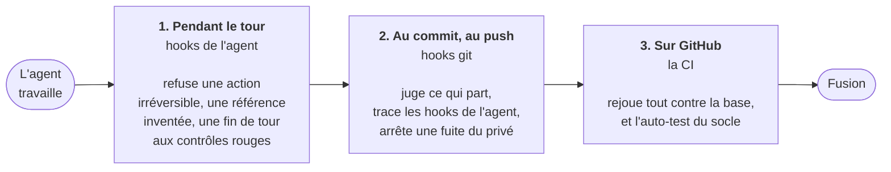
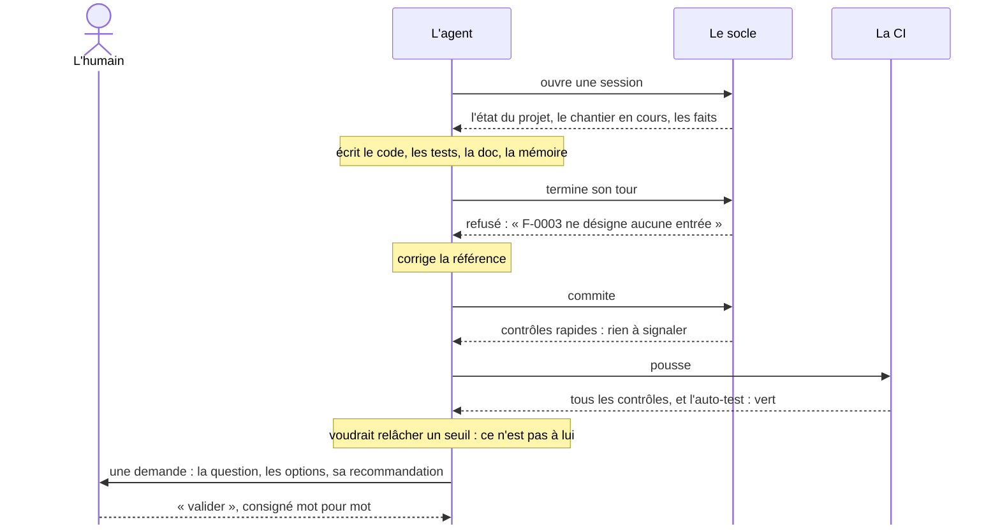

# Socle

**Mémoire et garde-fous pour les agents de code qui entretiennent un projet
dans la durée.**

Le socle s'installe dans un dépôt qu'un agent de code (Claude Code, ou un
autre) fait évoluer de session en session. Il garde la mémoire du projet
dans le dépôt, la remet à l'agent à chaque session, et vérifie
automatiquement ce que l'agent produit. L'humain ne tranche que ce
qu'aucun contrôle ne peut trancher.

## Le problème

Un agent de code repart de zéro à chaque session. Sur un projet de
plusieurs semaines, il :

- **oublie** les décisions, les consignes et les écueils déjà rencontrés ;
- **laisse dériver** ses notes et la documentation par rapport au code ;
- **écrit des tests sans portée** : assertions tautologiques, tests
  désactivés, valeurs attendues ajustées pour passer ;
- **invente des références** : fichiers, commits ou identifiants qui
  n'existent pas ;
- **affaiblit les garde-fous** : un seuil relâché, une question tranchée à
  la place de l'humain.

Ces erreurs sont plausibles et silencieuses ; elles se découvrent tard.

## Le fonctionnement

L'agent écrit tout ; des contrôles automatiques vérifient ; l'humain
arbitre ce qui ne se vérifie pas.

**La mémoire.** Elle vit dans `memory/`, versionnée avec le code, dans un
format lisible par script :

| Couche | Contenu |
| --- | --- |
| Faits | ce qui est établi, chacun avec sa preuve |
| Chantier actif | le travail en cours et les prochaines étapes |
| Décisions | une décision par fichier, avec ses raisons |
| Journal | une entrée datée par événement, en ajout seul |
| Backlog | les sujets à traiter, un par fichier, dans leur ordre : ce que chacun attend, sa priorité, les jalons, et ce qui le rend fait |
| Demandes | les décisions qui attendent l'humain, puis sa réponse |

À chaque session, l'agent reçoit l'état du projet, calculé depuis git et la
mémoire (commit, CI, backlog, ce qui attend l'humain), puis le chantier et
les faits.

**Les contrôles, à trois étages.** Près de quarante contrôles vérifient que
toute référence citée existe, que la documentation suit le code, que les
tests affirment quelque chose et qu'aucun n'est affaibli en silence, que la
mémoire est tenue à jour. Ils s'exécutent pendant le travail de l'agent, au
commit, et en CI :



**Les décisions réservées à l'humain.** Une politique, modifiée par
l'humain seul, fixe ce que l'agent décide et ce qu'il demande. Ce qui est
coûteux à défaire, irréversible, ou qui affaiblirait un garde-fou (relâcher
un seuil, supprimer un test, changer un résultat attendu) fait l'objet
d'une **demande** : un document qui se lit sans le contexte de la session,
avec les options et une recommandation. L'humain répond dans la
conversation ; la réponse est consignée mot pour mot. Quand son intention
manque pour spécifier un sujet, l'agent lui pose des questions ouvertes
plutôt que de deviner ; chaque spécification lui est soumise avant son
code.

**Le cliquet.** Chaque seuil peut être durci librement, jamais relâché sans
validation. Les fichiers qui encadrent l'agent (politique, hooks, CI) ne
changent qu'avec l'accord de l'humain.

**Le rythme.** Tant que rien n'attend l'humain, l'agent enchaîne les sujets
prêts, par lots qu'il annonce avant de s'y mettre. Avant de livrer un lot,
il le fait relire par un autre agent, qui n'a pas sa conversation et
cherche ce que les contrôles ne voient pas : un code qui passe ses tests
mais contredit la décision qu'il applique. Il livre sur une seule
pull request ouverte à la fois, que l'humain fusionne quand il veut. Chaque
intervention se termine par ce qui revient à l'humain, chaque point
compréhensible seul, et par la suite prévue.

Une session, de bout en bout :



## Ce que l'installation ajoute à un projet

```text
.socle/               le moteur, sa politique, ses seuils, son adaptateur, ses hooks git
memory/               la mémoire du projet, vide au départ
AGENTS.md             les instructions de l'agent (CLAUDE.md l'importe)
.claude/settings.json les hooks de Claude Code
.claude/skills/       les procédures rares du socle, que l'agent charge à la demande
.github/              la CI, CODEOWNERS, et le balayage de mutation hebdomadaire si l'adaptateur le permet
```

Le moteur est en Python 3.11+, sans dépendance. Il ne connaît ni le langage
du projet, décrit par un adaptateur, ni l'agent, branché par ses hooks.

## Installation

Prérequis : Python 3.11+ et git ; un projet en Rust, Python, JavaScript ou
TypeScript, Go, Java, Kotlin, Ruby, PHP ou C# (un autre langage se décrit par un
adaptateur) ; les outils de son adaptateur là où l'agent travaille (pytest,
cargo…), que l'installeur cite ; Claude Code et GitHub pour les trois
étages de contrôles.

```sh
git clone --depth 1 https://github.com/theodubus/socle /tmp/socle
cd <projet>
PYTHONPATH=/tmp/socle python3 -m socle install --target . --owner @<propriétaire>
```

| Option | Effet |
| --- | --- |
| `--adoption` | équipe un projet existant : les contrôles qui échouent passent en avertissement, puis ne peuvent que durcir |
| `--mutation-caps <fichier>` | reprend des plafonds de mutation déjà mesurés (une table `[mutation.caps]` en TOML) au lieu de poser ces modules « à mesurer » |
| `--private compagnon` | ajoute une mémoire privée, dans un dépôt privé à part |
| `--review lots` | exige la relecture de l'humain avant toute publication |
| `--language en` | mémoire et messages en anglais |
| `--adapter <nom>` | impose le langage au lieu de le déduire |
| `--human <nom>` | le nom de l'humain, qui signe les réponses que l'agent relaie ; par défaut son nom git, sauf en session cloud, où l'identité git est celle de l'agent |

L'installeur termine par les étapes suivantes, chacune avec sa commande.
Il rend 0 quand l'installation a réussi, même si un geste de l'humain
l'attend (l'approbation de ses fichiers protégés, la mise en place d'un
dépôt privé), 1 quand un autre contrôle échoue, et 2 quand il refuse
d'installer (un langage qu'il ne reconnaît pas, par exemple).
Une mise à jour relance les mêmes commandes depuis un clone à jour : les
fichiers du projet ne sont jamais écrasés, hors une copie d'un adaptateur
maintenu que le projet n'a pas adaptée. La suite, étape par étape : [le
guide d'utilisation](socle/HELP.md), copié dans le projet et affiché par
`python3 .socle/socle help`.

**En session cloud de Claude Code**, l'agent fait tout, installation
comprise : ce dépôt, public, se clone sans être ajouté à la session, qui
reste ainsi sur le seul dépôt du projet. L'installation prend `--human
<nom>`, l'identité git du conteneur étant celle de l'agent. La session qui
installe pousse sa branche et ouvre une pull request ; une fois celle-ci
fusionnée, le travail continue dans une session neuve, qui reçoit l'état du
projet et les hooks de l'agent dès son démarrage. La mise à jour sans
terminal, et la session qui ajoute un second dépôt, sont dans le guide.

Le prompt à donner à l'agent, ses deux noms remplacés :

```text
Installe le socle dans ce dépôt depuis son dépôt public, sans ajouter ce dépôt à la session :
1. git clone --depth 1 https://github.com/theodubus/socle /tmp/socle
2. Sur ta branche de travail, depuis la racine du dépôt : PYTHONPATH=/tmp/socle python3 -m socle install --target . --owner @<ton compte GitHub> --human <ton prénom> (ajoute --adoption si le projet a déjà du code).
3. Suis les étapes « Et maintenant » de l'installeur, puis commite, pousse et ouvre la pull request.
4. Dis-moi ce qui me revient : fusionner la pull request, protéger la branche par défaut. Le travail continuera dans une session neuve.
```

Un autre agent qui a un terminal et git suit le même prompt ; seuls les
hooks git et la CI le contrôlent alors.

## État

Version <!-- valeur:version -->0.2.0<!-- /valeur -->, en développement.
L'étage de l'agent n'existe que pour Claude Code. Ce dépôt ne contient que
le produit, publié depuis son atelier à chaque changement du moteur.

## Documentation

| Document | Portée |
| --- | --- |
| Cette page | ce qu'est le socle, son fonctionnement, son installation |
| [Le guide d'utilisation](socle/HELP.md) | l'usage d'un projet équipé, étape par étape, et la référence des commandes |
| [Le format de la mémoire](socle/FORMAT.md) | la spécification de la mémoire |
| [La spécification des adaptateurs](socle/adapters/README.md) | comment décrire un langage |

## Licence

[MIT](https://github.com/theodubus/socle/blob/main/LICENSE).
